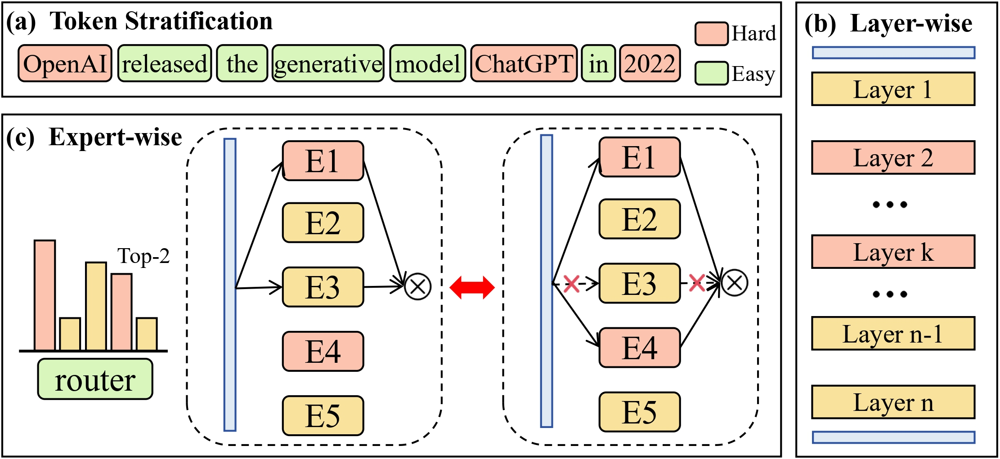
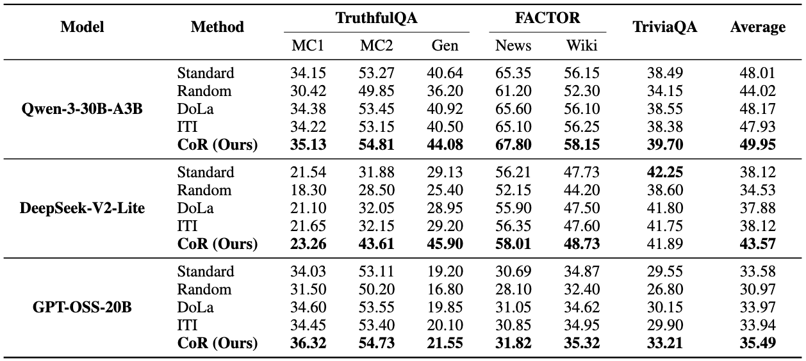

# Awakening Dormant Experts: Counterfactual Routing to Mitigate MoE Hallucinations

Official repository for the ACL 2026 paper:

> Awakening Dormant Experts: Counterfactual Routing to Mitigate MoE Hallucinations

## Overview

Sparse Mixture-of-Experts (MoE) models have achieved remarkable scalability, yet they remain vulnerable to hallucinations, particularly when processing long-tail knowledge. We identify that this fragility stems from static Top-*k* routing: routers tend to favor high-frequency patterns over rare factual associations. Consequently, `specialist experts` possessing critical long-tail knowledge are often assigned low gating scores and remain `dormant`---under-prioritized for specific tokens despite their proven causal importance on other inputs. To address this, we propose Counterfactual Routing (CoR), a training-free inference framework designed to awaken these dormant experts. CoR integrates layer-wise perturbation analysis with the Counterfactual Expert Impact (CEI) metric to dynamically shift computational resources from syntax-dominant to knowledge-intensive layers while maintaining a constant total activation count, effectively retrieving causally decisive experts via virtual ablation. Extensive experiments on TruthfulQA, FACTOR, and TriviaQA demonstrate that CoR improves factual accuracy by 3.1% on average without increasing the inference budget, establishing a superior Pareto frontier compared to static scaling strategies.


_Figure 1. Overview of the Offline Causal Analysis pipeline. The framework consists of three hierarchical stages: (a) Token Stratification: We stratify tokens into hard (knowledge-intensive) and easy (syntax-dominant) subsets based on model uncertainty to disentangle factual reasoning from generic processing. (b) Layer-wise Analysis: We apply Contrastive Sensitivity Normalization to identify knowledge-intensive layers by measuring their relative sensitivity ($R_l$) to hard tokens while mitigating error cascading. (c) Expert-wise Analysis: We compute CEI via virtual ablation to uncover `dormant` experts---causally critical on some tokens but under-prioritized on others._


## Repository Structure

The repository is organized around the three offline causal-analysis stages of CoR plus the inference-time routing framework:

```
├── token_stratification/   # Stage (a): Token Stratification — hard vs. easy tokens
├── layer_analysis/         # Stage (b): Layer-wise Analysis — Contrastive Sensitivity Normalization (R_l)
├── expert_analysis/        # Stage (c): Expert-wise Analysis — Counterfactual Expert Impact (CEI) & top-k allocation
└── inference/              # Counterfactual Routing (CoR) inference evaluation via lm-evaluation-harness
```

## Usage

The code targets **Qwen3-30B-A3B**. Each stage runs offline and produces the artifacts consumed by the next stage.

### 0. Requirements
- Python 3.10+, PyTorch, `transformers`, `datasets`, `numpy`, `tqdm`, `matplotlib`
- [`lm-evaluation-harness`](https://github.com/EleutherAI/lm-evaluation-harness) with the custom `custom_our` / `custom_moe` model backends (for the inference stage).

### 1. Token Stratification (Stage a)
Compute per-token loss on a calibration corpus and stratify tokens into *hard* (knowledge-intensive, top-q loss) and *easy* (syntax-dominant, bottom-q loss) subsets:

```bash
python token_stratification/getHardTokens_new.py \
    --model_name /path/to/Qwen3-30B-A3B \
    --dataset_path /path/to/c4.json \
    --output_path ./data/hard_samples.jsonl \
    --q 0.1 --max_length 1024
```
The *easy* subset is obtained symmetrically by thresholding the bottom-q losses. `analyze_dataset_length.py` helps choose `--max_length`.

### 2. Layer-wise Analysis (Stage b)
For each layer, perturb the layer output and measure the loss change on hard vs. easy tokens. The relative sensitivity $R_l$ = hard/easy (`layer_sensitivities_ratio.json`) is the Contrastive Sensitivity Normalization score. In `--comprehensive` mode, the run also computes the per-expert Counterfactual Expert Impact (CEI) via virtual ablation: `CEI_e = loss_without_e − loss_with_e`, averaged over the hard tokens routed to expert *e* (`expert_cei_scores.json`). Note: CEI is a per-expert causal-impact score, **not** the hard/easy ratio.

```bash
cd layer_analysis
python run_layer_sensitivity_sampled.py \
    --model /path/to/Qwen3-30B-A3B \
    --hard_tokens /path/to/hard_samples.jsonl \
    --easy_tokens /path/to/easy_samples.jsonl \
    --dataset_path /path/to/c4.jsonl \
    --comprehensive --max_samples 1000 \
    --generate_topk --min_topk 8 --max_topk 16 \
    --output_dir ./sensitivity_results
```
Single-GPU: `bash single.sh`; multi-GPU: `bash multi.sh`.

### 3. Expert-wise Analysis (Stage c)
Map the layer-wise ratio scores R_l to a per-layer top-k budget (constant total activation count), shifting capacity from syntax-dominant to knowledge-intensive layers:

```bash
cd expert_analysis
# edit INPUT_FILE/OUTPUT_FILE in get_layer_k_total.py to point at layer_sensitivities_ratio.json
python get_layer_k_total.py      # constant-budget allocation
python get_layer_k.py            # simple min-max / rank allocation
```

### 4. Inference (CoR evaluation)
Run CoR with the offline-computed layer budget and CEI scores:

```bash
cd inference
# edit MODEL_PATH, LAYER_K, CEI_SCORES in test_our.sh, then:
bash test_our.sh                 # CoR (custom_our: layer_k + CEI)
bash test_k_8.sh                 # baseline: fixed top-8
bash test_16_8.sh                # baseline: static budget allocation
bash test_dynamic.sh             # baseline: dynamic per-layer top-k
```

## Experiments
Table 1. Zero-shot performance of Counterfactual Routing (CoR) compared with baseline methods on factuality benchmarks. CoR is compared with Standard Top-*k* routing, Random routing, and inference-time interventions (DoLa, ITI) across three architectures. Best scores are in bold.



## Citation

If you find our project useful, we hope you can star our repo and cite our paper as follows:
```
@inproceedings{hu2026awakening,
  title={Awakening Dormant Experts: Counterfactual Routing to Mitigate MoE Hallucinations},
  author={Hu, Wentao and Zhai, Yanbo and Hu, Xiaohui and Zhao, Mingkuan and Liu, Xue and Yu, Kaidong and Song, Shuangyong and Li, Xuelong and others},
  booktitle={Proceedings of the 64th Annual Meeting of the Association for Computational Linguistics (Volume 1: Long Papers)},
  pages={47257--47271},
  year={2026}
}
```
